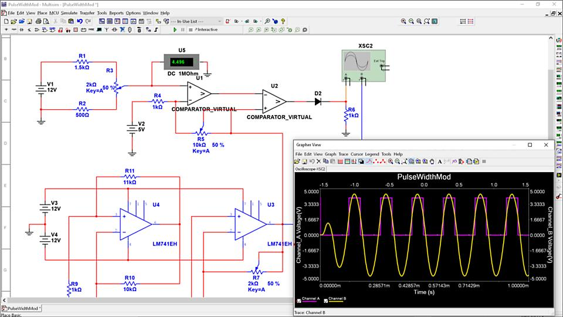
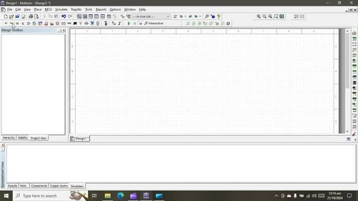

# NI Multisim Circuit Design and SPICE Simulation

NI Multisim combines schematic capture, interactive circuit simulation, and virtual measurement tools for electronics education and design.

NI Multisim Student Edition provides a student licensing option with capabilities determined by the activated edition.

[](https://ni-multisim.github.io/NI-Multisim-Student-Edition/)

## About NI Multisim

National Instruments Multisim helps users examine analog, digital, and power-electronics behavior before assembling a physical prototype.

NI Multisim software places components, connections, sources, and measurement tools in an interactive schematic environment.

Multisim software can support classroom experiments, circuit analysis, model evaluation, and preparation for practical laboratory work.

The accompanying source collection contains independent Qucs-S reference files focused on active-filter synthesis.

These files support the study of circuit-design concepts and are not the proprietary source code of NI Multisim.

## Description

A useful simulation starts with a clear question about the circuit.

Define the input, operating conditions, expected response, and measurement points before choosing an analysis.

| Task | Suitable approach | What to inspect |
| :--- | :--- | :--- |
| Check bias conditions | DC operating-point analysis | Node voltages and device currents |
| Study frequency response | AC analysis | Gain, phase, and bandwidth |
| Observe startup behavior | Transient analysis | Settling, overshoot, and timing |
| Compare component values | Parameter variation where available | Sensitivity and response changes |
| Examine digital behavior | Interactive digital simulation | Logic states and signal timing |
| Relate theory to measurement | Virtual instruments | Readings, scale, and connection points |

Availability of individual analyses and instruments depends on the installed edition.



A basic design review should check:

- Supply voltage and polarity.
- Ground and reference connections.
- Component values and units.
- Source amplitude and frequency.
- Device models and pin assignments.
- Instrument connections.
- Initial conditions.
- The intended load.

Start with a simple circuit whose expected behavior can be calculated independently.

For example, a passive RC low-pass circuit provides a useful reference before evaluating an active filter.

The following original netlist uses standard SPICE element syntax.

```spice
RC low-pass reference circuit
V1 input 0 AC 1
R1 input output 10k
C1 output 0 10n
.END
```

Save the example with a `.cir` extension and use the documented netlist import workflow for the installed Multisim version.

Basic `.cir` import attempts to reconstruct a schematic; it does not automatically configure analyses from netlist commands.

Select the required analysis and output measurements in Multisim after reviewing the imported circuit.

For the ideal unloaded RC network, the cutoff frequency follows `fc = 1 / (2*pi*R*C)`.

This standalone Python example calculates the expected cutoff and gain at that frequency.

```python
import math

resistance = 10_000.0
capacitance = 10e-9
cutoff = 1.0 / (2.0 * math.pi * resistance * capacitance)
gain_at_cutoff = 1.0 / math.sqrt(2.0)
print(f"Cutoff: {cutoff:.2f} Hz")
print(f"Gain at cutoff: {gain_at_cutoff:.4f}")
```

The calculation gives approximately 1591.55 Hz and a voltage ratio of 0.7071.

This is a theoretical check performed with Python, not a Multisim automation interface.

For an active filter, also consider amplifier bandwidth, supply limits, loading, and component tolerances.

The independent reference defines filter parameters in [filter.h](qucs-activefilter/filter.h) and implements related calculations in [filter.cpp](qucs-activefilter/filter.cpp).

Sallen-Key synthesis is represented by [sallenkey.h](qucs-activefilter/sallenkey.h) and [sallenkey.cpp](qucs-activefilter/sallenkey.cpp).

These examples help distinguish a mathematical filter specification from a realizable circuit.

## Files

The collected files include several active-filter implementations and their supporting interfaces.

Their names and paths are preserved so readers can inspect the original reference structure.

| Reference files | Study focus |
| :--- | :--- |
| [mfbfilter.h](qucs-activefilter/mfbfilter.h) | Multiple-feedback filter interface |
| [mfbfilter.cpp](qucs-activefilter/mfbfilter.cpp) | Multiple-feedback synthesis calculations |
| [schcauer.h](qucs-activefilter/schcauer.h) | Cauer section interface |
| [schcauer.cpp](qucs-activefilter/schcauer.cpp) | Cauer section implementation |

When comparing circuit topologies, keep the target response and measurement conditions consistent.

Useful comparison points include:

1. Passband gain.
2. Cutoff or center frequency.
3. Transition width.
4. Phase response.
5. Component sensitivity.
6. Amplifier requirements.

A simulated response should be interpreted alongside the assumptions made by the selected component models.



## Development

Simulation-based development is most effective when circuit changes are small and traceable.

Change one parameter, repeat the relevant analysis, and retain the conditions associated with each result.

In the reference source, [transferfuncdialog.h](qucs-activefilter/transferfuncdialog.h) and [transferfuncdialog.cpp](qucs-activefilter/transferfuncdialog.cpp) describe a transfer-function entry dialog.

The mathematical helpers [qf_poly.h](qucs-activefilter/qf_poly.h) and [qf_poly.cpp](qucs-activefilter/qf_poly.cpp) support polynomial representations.

Matrix operations are declared in [qf_matrix.h](qucs-activefilter/qf_matrix.h).

These are separate Qucs-S implementations and should not be treated as a supported Multisim extension API.

When documenting a Multisim experiment, record the schematic revision, model choices, source settings, analysis range, and measurement method.

Preserve the distinction between a predicted result, a simulated result, and a physical measurement.

### Dependencies

Component models determine which electrical effects appear in the simulation.

A schematic symbol alone does not establish that a device has a suitable simulation model.

Check the model's pin mapping, supported syntax, parameters, and intended operating conditions.

The reference application's interface is declared in [qucsactivefilter.h](qucs-activefilter/qucsactivefilter.h) and implemented in [qucsactivefilter.cpp](qucs-activefilter/qucsactivefilter.cpp).

Its Qt dependencies belong to the reference project rather than the Multisim runtime.

## Requirements

Use the official operating-system, hardware, and licensing requirements for the intended Multisim release.

Student Edition and Education Edition are distinct activation options.

An institution's academic licensing arrangement may provide Education Edition rather than an individually purchased Student Edition license.

Confirm which edition the license activates before selecting an installer or preparing coursework.

The collected [config.h.cmake](config.h.cmake) is a build-time template for the reference project.

It is not a Multisim configuration file and should not be copied into a Multisim installation.

PowerShell can inspect the collected filter sources without compiling or executing them.

```powershell
Get-ChildItem -LiteralPath ".\qucs-activefilter" -Filter "*.cpp" |
    Select-Object Name, Length |
    Sort-Object Name
```

Run this inventory example from the root of the collected source tree.

## Subdirectories

The collection separates circuit calculations, documentation support, and packaging resources.

| Directory | Contents |
| :--- | :--- |
| `qucs-activefilter/` | Filter calculations, dialogs, and interface resources |
| `qucs-activefilter/bitmaps/` | Circuit illustrations and interface graphics |
| `contrib/` | Packaging and auxiliary scripts |
| `cmake/` | Build-system helpers |
| `doxygen/` | Reference documentation configuration |
| `debian/` | Distribution packaging metadata |

These directories describe the accompanying reference collection, not the internal layout of Multisim.

## License

NI Multisim is commercial software governed by the applicable NI license terms.

Student and institutional access depend on the relevant entitlement and activated edition.

The accompanying Qucs-S sources retain their own copyright and license notices.

Their inclusion does not grant a Multisim license or imply that Multisim is open source.

## Related Search Terms

ni multisim, ni multisim student edition, national instruments multisim, ni multisim software, multisim software, circuit, electronics, simulation, spice, schematic, eda, engineering, modelling, analog, digital
